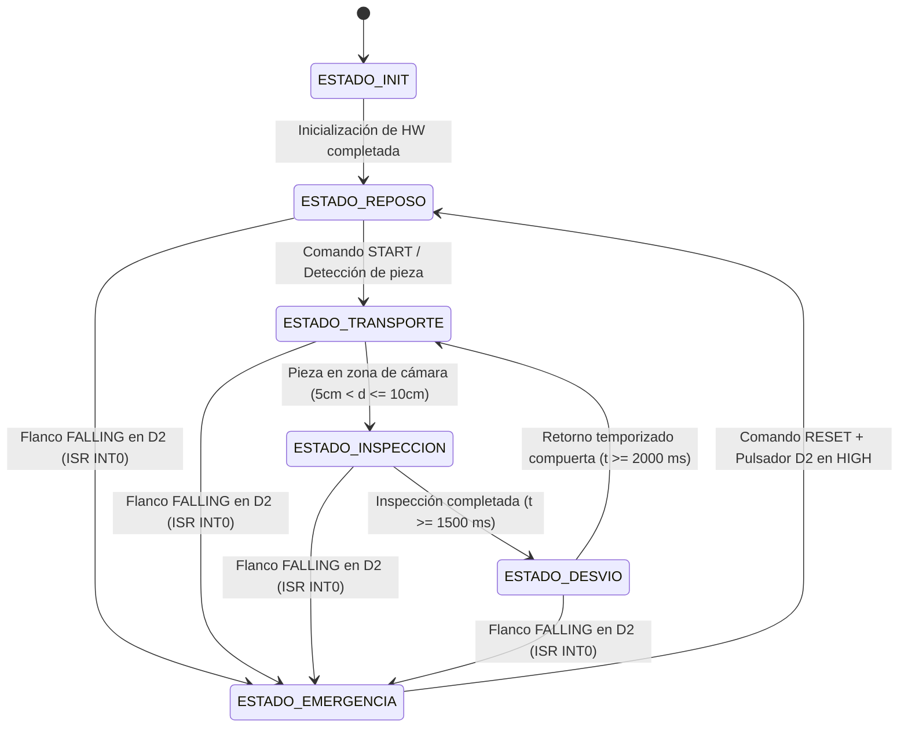

# MEMORIA TÉCNICA DE INGENIERÍA: ESTACIÓN LOGÍSTICA DE SELECCIÓN, CLASIFICACIÓN Y ENRUTAMIENTO

**Plataforma de Control:** Arduino Uno R3 (Microcontrolador ATmega328P)  
**Arquitectura de Software:** Multitarea Cooperativa No Bloqueante + FSM + 3 Lazos Cerrados  
**Estándar de Seguridad:** Manejo de Interrupciones por Hardware (INT0) / Parada de Emergencia SIL-ready  
**Plataforma de Gemelo Digital 3D:** C++ Standalone (Win32 + OpenGL, 496 KB) & Python PyOpenGL (GPU Optimized)  
**Subsistema CAD 3D:** Modelado Paramétrico Normalizado (GrabCAD) en OBJ y Binary STL (`modelsd/`)  

---

## 1. ESPECIFICACIÓN Y ASIGNACIÓN ESTRICTA DE PINES (HARDWARE MAP)

A fin de garantizar cero colisiones entre timers de hardware (Timer 0, Timer 1, Timer 2), canales PWM, módulos de interrupción externa e interfaces serie/I2C, se establece la siguiente distribución física:

| Pin Arduino | Función / Periférico | Tipo de Señal | Timer / Canal Asociado | Justificación de Ingeniería |
| :--- | :--- | :--- | :--- | :--- |
| **D0 (RX)** | Telemetría Serial / BT HC-05 | Digital In | USART Nativo | Recepción de tramas y comandos a 9600 bps. |
| **D1 (TX)** | Telemetría Serial / BT HC-05 | Digital Out | USART Nativo | Transmisión de telemetría periódica CSV/JSON. |
| **D2 (INT0)** | Pulsador Parada Emergencia | Digital In (Pull-up) | Interrupción Externa INT0 | Desconexión por hardware en < 5 µs ante flanco `FALLING`. |
| **D3 (PWM)** | ENA Driver Puente H L298N | Salida PWM | Timer 2 (OC2B, 490 Hz) | Regulación lineal de velocidad faja transportadora (Lazo 1). |
| **D4** | IN1 Driver Puente H L298N | Salida Digital | GPIO General | Control de sentido de giro motor DC. |
| **D5 (PWM)** | Servomotor SG90 (Compuerta) | Salida PPM | Timer 0 / Servo.h | Control angular de desvío hacia tolvas (Lazo 2). |
| **D6 (PWM)** | Base Transistor NPN (LEDs) | Salida PWM | Timer 0 (OC0A, 980 Hz) | Modulación de intensidad lumínica para inspección (Lazo 3). |
| **D7** | IN2 Driver Puente H L298N | Salida Digital | GPIO General | Control de sentido de giro motor DC. |
| **D8** | Trigger Sensor HC-SR04 | Salida Digital | GPIO General | Disparo de pulso acústico (10 µs). |
| **D9** | Echo Sensor HC-SR04 | Entrada Digital | GPIO (PCINT1) | Captura del tiempo de vuelo con timeout de 18 ms. |
| **D10** | Buzzer Activo de Alarma | Salida Digital | GPIO General | Señalización acústica intermitente en emergencias. |
| **D11** | LED Verde (Marcha) | Salida Digital | GPIO General | Estado de marcha / transporte en curso. |
| **D12** | LED Amarillo (Inspección) | Salida Digital | GPIO General | Estado de inspección óptica / espera. |
| **D13** | LED Rojo (Alarma) | Salida Digital | GPIO General | Destello visual de emergencia y fallas. |
| **A0** | Sensor LDR (Divisor 10 kΩ) | Entrada Analógica | ADC Canal 0 (10 bits) | Medición de iluminancia relativa (0 a 100%) (Lazo 3). |
| **A1** | Potenciómetro de Calibración| Entrada Analógica | ADC Canal 1 (10 bits) | Ajuste manual continuo de Setpoint de iluminancia. |
| **A4 (SDA)**| Pantalla LCD 16x2 I2C | Bus I2C | TWI / I2C Hardware | Bus de datos para HMI local (Dirección `0x27`). |
| **A5 (SCL)**| Pantalla LCD 16x2 I2C | Bus I2C | TWI / I2C Hardware | Bus de reloj para HMI local. |

---

## 1.1 TABLA DE INSTRUMENTACIÓN Y TAGS (NORMA ANSI / ISA-5.1)

Conforme a la norma **ANSI / ISA-5.1 (Instrumentation Symbols and Identification)**, los elementos de campo, controladores y actuadores de la estación se identifican con los siguientes Tags normalizados:

| Tag ISA-5.1 | Tipo de Instrumento / Símbolo | Ubicación / Conexión | Función en el Sistema |
| :--- | :--- | :--- | :--- |
| **`HS-100`** | Hand Switch (Discreto Campo ◯) | Pin 2 (INT0 Pull-up) | Pulsador de Parada de Emergencia operado manualmente. |
| **`I-100`** | Safety Interlock (Rombo ❖) | Firmware / ISR INT0 | Enclavamiento de seguridad por hardware (< 5 µs). |
| **`ZT-101`** | Position Transmitter (Discreto Campo ◯) | Pines D8 (Trig) / D9 (Echo) | Transmisor de distancia ultrasónica por tiempo de vuelo. |
| **`ZIC-101`** | Position Indicating Controller (Shared 🔲+◯) | Firmware Arduino Uno | **Lazo 1:** Controlador proporcional de velocidad y anticolisión. |
| **`SC-101`** | Speed Controller / Drive (Actuador) | Pin 3 (ENA) / Pines D4, D7 | Driver Puente H L298N de tracción. |
| **`M-101`** | Motor DC de Proceso | Faja Transportadora CV-100 | Motorreductor DC de accionamiento de la banda. |
| **`ZIC-102`** | Position Indicating Controller (Shared 🔲+◯) | Firmware Arduino Uno | **Lazo 2:** Servocontrol cinemático de enrutamiento angular. |
| **`ZY-102`** | I/P Converter / Servo Driver | Pin 5 (PPM / Timer 0) | Micro servomotor SG90 con lazo interno de posición. |
| **`XV-102`** | 3-Way Diverter Gate (Válvula/Compuerta) | Salida Mecánica de Faja | Compuerta física de desvío hacia 3 tolvas (45°, 90°, 135°). |
| **`QE-103`** | Quality / Light Sensor Element (Campo ◯) | Pin A0 (Divisor 10 kΩ) | Fotorresistencia LDR en zona de inspección óptica. |
| **`QT-103`** | Light Transmitter (Campo ◯) | Pin A0 (ADC 10-bit) | Transmisor de iluminancia relativa (0 a 100%). |
| **`QIC-103`** | Quality Indicating Controller (Shared 🔲+◯) | Firmware Arduino Uno | **Lazo 3:** Estabilización proporcional de iluminancia. |
| **`QY-103`** | Power Modulator / Driver | Pin 6 (PWM Timer 0) | Transistor NPN (TIP120/2N2222) de potencia. |
| **`QL-103`** | Inspection Luminaire | Zona de Cámara | Banco de luminarias LED de inspección óptica. |

---

## 2. FORMULACIÓN MATEMÁTICA Y DINÁMICA DE LOS TRES LAZOS DE CONTROL

```mermaid
graph TD
    subgraph "Lazo 1: Anticolisión y Velocidad"
    HC[HC-SR04 Distancia PV] -->|PV| CTRL1[Controlador Proporcional P1]
    SP1[Setpoint: 25 cm] -->|SP| CTRL1
    CTRL1 -->|PWM ENA D3| L298N[Driver L298N + Motor DC]
    end

    subgraph "Lazo 2: Enrutamiento Angular"
    CAM[Inspección / Calidad] -->|Comando| CTRL2[Controlador Servo P2]
    CTRL2 -->|Ángulo PPM D5| SG90[Micro Servomotor SG90]
    SG90 -->|45°/90°/135°| TOLVAS[Tolvas: Retrabajo / Conforme / Rechazo]
    end

    subgraph "Lazo 3: Estabilización de Iluminación"
    LDR[Sensor LDR A0] -->|Lux PV| CTRL3[Controlador Proporcional P3]
    SP3[Setpoint: 70% Lux] -->|SP| CTRL3
    CTRL3 -->|PWM D6| NPN[Transistor NPN + Banco LED]
    NPN -->|Iluminancia| ZONA[Zona de Captura Óptica]
    ZONA -.->|Retroalimentación| LDR
    end
```



### Lazo 1: Regulación Proporcional de Velocidad y Frenado Anticolisión
* **Variable de Proceso ($PV$):** Distancia al obstáculo o pieza subsiguiente en centímetros ($d(t)$) leída por el HC-SR04.
* **Punto de Consigna ($SP$):** Distancia segura nominal $SP_{dist} = 25.0 \text{ cm}$. Umbral de parada crítica $d_{stop} = 5.0 \text{ cm}$.
* **Variable Manipulada ($CV$):** Ciclo de trabajo PWM aplicado a ENA ($PWM_{motor} \in [0, 255]$).
* **Ecuación de Control por Tramos:**

$$\text{PWM}_{motor}(d) = \begin{cases} 
0 & \text{si } d \le 5.0\text{ cm} \quad (\text{Parada de Protección}) \\
\text{round}\left( \frac{d - 5.0}{25.0 - 5.0} \times 200 \right) & \text{si } 5.0 < d < 25.0\text{ cm} \quad (\text{Rampa Proporcional}) \\
200 & \text{si } d \ge 25.0\text{ cm} \quad (\text{Régimen Nominal})
\end{cases}$$

* **Ganancia Proporcional en el Rango Lineal:**
  $$K_{p1} = \frac{200 - 0}{25.0 - 5.0} = 10.0 \frac{\text{PWM}}{\text{cm}}$$

---

### Lazo 2: Servocontrol de Posicionamiento Angular de Desvío
* **Variable de Entrada:** Clasificación de pieza obtenida en estación de inspección ($\text{ID} \in \{\text{RETRABAJO}, \text{CONFORME}, \text{RECHAZO}\}$).
* **Variable Manipulada:** Ancho de pulso PPM / Posición angular $\theta \in [0^\circ, 180^\circ]$ en Pin D5.
* **Mapeo Cinemático de Enrutamiento:**

$$\theta_{servo} = \begin{cases}
45^\circ & \text{si Clasificación} = \text{RETRABAJO} \quad \rightarrow \text{Tolva Lateral Izquierda / Carro Z = +0.16 m} \\
90^\circ & \text{si Clasificación} = \text{CONFORME} \quad \rightarrow \text{Paso Directo / Carro Z = 0.00 m} \\
135^\circ & \text{si Clasificación} = \text{RECHAZO} \quad \rightarrow \text{Tolva Lateral Derecha / Carro Z = -0.16 m}
\end{cases}$$

* **Dinámica de Restablecimiento:** Temporizador no bloqueante $T_{desvio} = 2000 \text{ ms}$. Tras expirar el tiempo de eyección, la compuerta retorna automáticamente a $\theta = 90^\circ$.

---

### Lazo 3: Estabilización Proporcional de Iluminación de Inspección
* **Variable de Proceso ($PV$):** Iluminancia relativa en zona de captura $L_{PV} \in [0\%, 100\%]$ medida por la LDR en A0.
* **Punto de Consigna ($SP$):** Setpoint requerido para la cámara de visión artificial $L_{SP} = 70.0\%$.
* **Error de Iluminación:**
  $$e_{lux}(t) = L_{SP} - L_{PV}(t)$$
* **Ecuación del Controlador Proporcional:**
  $$PWM_{luz}(t) = \text{constrain}\left( PWM_{base} + K_{p3} \cdot e_{lux}(t) \cdot 2.55, \, 0, \, 255 \right)$$
  Donde:
  - $PWM_{base} = 128$ (Punto de polarización al 50% de ciclo de trabajo).
  - $K_{p3} = 2.5$ (Ganancia proporcional de compensación).
  - Si la luz ambiental cae de 60% a 20% ($e = +50\%$), la salida satura positivamente a 255 PWM para compensar la pérdida de luz en menos de 100 ms.

---

## 3. TABLA FORMAL DE TRANSICIÓN DE ESTADOS (FSM)



### Matriz Detallada de Transiciones

| Estado Actual | Condición / Evento Trigger | Acciones Inmediatas del Microcontrolador | Estado Siguiente |
| :--- | :--- | :--- | :--- |
| **`ESTADO_INIT`** | Finalización de configuración de timers, I2C y pines. | Apagar actuadores, centrar servo a 90°, limpiar LCD, enviar JSON de arranque. | **`ESTADO_REPOSO`** |
| **`ESTADO_REPOSO`** | Recepción de comando serie `START` o detección de lote. | Encender LED Verde (D11), habilitar lazo de velocidad Lazo 1. | **`ESTADO_TRANSPORTE`** |
| **`ESTADO_TRANSPORTE`** | Sensor ultrasónico detecta pieza en zona: $5\text{cm} < d \le 10\text{cm}$. | Detener faja ($PWM_{motor}=0$), encender LED Amarillo (D12), activar temporizador $t_{insp}$. | **`ESTADO_INSPECCION`** |
| **`ESTADO_INSPECCION`** | Transcurso de $t_{insp} \ge 1500\text{ ms}$. | Evaluar fotometría / comando, fijar ángulo en servo SG90 (45°, 90° o 135°), iniciar $t_{desvio}$. | **`ESTADO_DESVIO`** |
| **`ESTADO_DESVIO`** | Transcurso de $t_{desvio} \ge 2000\text{ ms}$. | Reposicionar servo SG90 a 90°, reiniciar clasificador, volver a mover faja. | **`ESTADO_TRANSPORTE`** |
| **Cualquiera** | Pulsación Parada Emergencia (Flanco `FALLING` D2). | **ISR:** Forzar PWM Motor = 0, PWM Luz = 0, encender destello LED Rojo + Buzzer. | **`ESTADO_EMERGENCIA`** |
| **`ESTADO_EMERGENCIA`**| Comando `RESET` recibido AND lectura de D2 en `HIGH`. | Desactivar alarma visual/acústica, servo a 90°, limpiar flags de falla. | **`ESTADO_REPOSO`** |

---

## 4. PROTOCOLO DE COMUNICACIÓN Y TELEMETRÍA

### 4.1 Trama de Telemetría Periódica (CSV a 9600 bps cada 200 ms)
```text
TLM,<ESTADO_FSM>,<DIST_CM>,<PWM_MOTOR>,<LUX_PCT>,<SERVO_DEG>,<EMERGENCY_FLAG>
```
* **Ejemplo en Operación Normal:**  
  `TLM,TRANSP,22.4,174,70.2,90,0`
* **Ejemplo en Condición de Emergencia:**  
  `TLM,EMERG!,4.2,0,0.0,90,1`

### 4.2 Tramas de Eventos Asíncronos (Formato JSON)
* **Arranque:** `{"MSG":"SISTEMA_INICIADO","STATUS":"OK","BAUD":9600}`
* **Activación de Emergencia:** `{"ALERTA":"PARADA_EMERGENCIA_ACTIVADA","TIMESTAMP_MS":14250}`
* **Resultado de Clasificación:** `{"EVENTO":"CLASIFICACION_COMPLETA","RESULTADO":"RETRABAJO","ANGULO":45}`

### 4.3 Diccionario de Comandos Remotos
| Comando Serie | Parámetros | Descripción / Efecto |
| :--- | :--- | :--- |
| `START` | Ninguno | Inicia el transporte desde el estado de reposo. |
| `STOP` | Ninguno | Detiene la faja y pasa a estado de reposo seguro. |
| `RESET` | Ninguno | Rearma el sistema tras una parada de emergencia si el botón físico fue liberado. |
| `CLASSIFY:<TIPO>` | `CONFORME` \| `RETRABAJO` \| `RECHAZO` | Forzado manual o por sistema de visión artificial externo. |
| `SIM_DIST:<VAL>` | Float (ej. `SIM_DIST:8.5`) | Inyección HIL de distancia para emulación sin sensor físico. |
| `SIM_LDR:<VAL>` | Float (ej. `SIM_LDR:35.0`) | Inyección HIL de iluminancia para prueba de lazo de luz. |
| `SIM_OFF` | Ninguno | Retorno a lectura de transductores físicos en tiempo real. |

---

## 5. GUÍA DE EJECUCIÓN DEL EMULADOR DE PLANTA HIL

### 5.1 Requisitos de Software
```bash
pip install -r emulator/requirements.txt
```

### 5.2 Modo Simulación Autónoma (Gráficos en Tiempo Real)
Ejecute el emulador interactivo con visualización de los 4 lazos y banco de prueba:
```bash
python emulator/plant_emulator.py
```
* **Controles en Teclado:**
  - `[N]`: Generar nueva pieza en el alimentador de entrada.
  - `[L]`: Inyectar perturbación brusca de luz ambiental (caída a 15% / recuperación).
  - `[E]`: Presionar / Liberar pulsador de Parada de Emergencia.

### 5.3 Modo Hardware-In-The-Loop (Conexión a Placa Arduino Real)
Conecte el Arduino Uno R3 vía USB (ej. puerto `COM3` a 9600 baudios):
```bash
python emulator/plant_emulator.py --hil COM3
```
El script inyectará dinámicamente las variables de física calculadas (distancia ultrasónica y respuesta de fotocelda) y recibirá las salidas de potencia PWM de los lazos del microcontrolador en tiempo real.

---

## 6. ARQUITECTURA DEL GEMELO DIGITAL 3D INDUSTRIAL (C++ Y PYTHON)

El sistema cuenta con un motor gráfico de simulación dual que reproduce fielmente la física continua y los mecanismos industriales:

```
┌────────────────────────────────────────────────────────────────────────────────────────┐
│                        ESPACIO 3D LIBRE: CAMARA ORBITAL / ESTACION                     │
├────────────────────────────────────────────────────────────────────────────────────────┤
│ CONSOLA DE SUPERVISION INDUSTRIAL // AUTO-TIF v2.4             ATmega328P • FPS: 60.0  │
├──────────────────────────┬────────────────────────────┬────────────────────────────────┤
│ CRT-1: TELEMETRIA FSM    │ CRT-2: MATRIZ DIGITAL OEE  │ TABLERO DE ACCIONAMIENTO       │
│ • Estado FSM: TRANSP     │ • TOTAL:    128 unidades   │ [ INICIAR ]  [ DETENER ] [ESTOP]
│ • ZT-101: 24.5 cm        │ • CONFORME: 110 ( 86.0%)   │ [+ CAJA ]    [ RESET ]   [LUZ] │
│ • PWM Motor: 82%         │ • RETRABAJO: 12 (  9.4%)   │                                │
│ • PID LED:   65%         │ • RECHAZO:    6 (  4.6%)   │ SELECTOR DE CAMARAS:           │
│ • Servo Desvío: 90°      │ • L1..L4: Lámparas Estado  │ [V1:ISO] [V2:CAM] [V3..V5]     │
└──────────────────────────┴────────────────────────────┴────────────────────────────────┘
```

### A. Consola Retro Industrial Unificada de Supervisión (195 px de altura)
* **Objetivo Ergonómico:** Se agruparon todos los controles y paneles flotantes en una sola barra industrial inferior, dejando el $100\%$ del campo de visión superior limpio para la inspección visual 3D.
* **Módulo CRT-1 (Fósforo Verde):** Emula un monitor CRT de tubo de rayos catódicos con líneas de escaneo (*scanlines*), indicando el estado del microcontrolador ATmega328P (`REPOSO`, `TRANSP`, `INSPEC`, `DESVIO`, `EMERG!`), telemetría de posición del sensor ultrasónico y lazo PWM de tracción.
* **Módulo CRT-2 (Matriz LED OEE y Estado de Hardware):** Matriz 2x2 para contabilización continua de piezas y 4 indicadores luminosos con bisel metálico (`L1: SISTEMA OK`, `L2: MOTOR RUN`, `L3: SONAR ACTIVE`, `L4: PID LED ON`).
* **Módulo de Mando Mecánico:** Botonera 3D con relieve táctil, selector de cámaras técnicas (V1: Isométrica, V2: Cámara, V3: Lateral, V4: Carro, V5: Tolva) y pulsador de parada de emergencia (`! E-STOP !`) con perímetro rayado de seguridad amarillo/negro.

### B. Cinemática Mecánica de la Estación 3D
1. **Tolva de Alimentación por Gravedad:** Almacena piezas en espera en boca inclinada que descienden de manera temporizada hacia la banda.
2. **Faja Transportadora Bosch Rexroth:** Banda de caucho con nervaduras de tracción continuas impulsada por motorreductor DC con Lazo 1 anticolisión.
3. **Módulo de Visión Artificial:** Campana de iluminación regulada por Lazo 3 con cono de luz volumétrico semitransparente que no ocluye las piezas.
4. **Carro Lanzadera Móvil de Gavetas (`cart_z`):** En lugar de puntos de acopio estáticos, un motor posiciona automáticamente un carro lanzadera en el eje $Z$ ($Z = 0.00\text{ m}$ para Conforme, $Z = +0.16\text{ m}$ para Retrabajo, $Z = -0.16\text{ m}$ para Rechazo) sincronizado con el ángulo de la compuerta servo.

---

## 7. DIAGNÓSTICO Y RESOLUCIÓN DE CUELLOS DE BOTELLA EN PYTHON (GPU OPTIMIZATION)

Se eliminaron los dos factores principales de degradación de cuadros por segundo en PyOpenGL:

### A. *Texture Thrashing* en la Consola HUD
* **Problema:** En cada frame se generaban más de 35 cadenas de texto. El ciclo `font.render()` (CPU) $\rightarrow$ `glGenTextures()` $\rightarrow$ `glTexImage2D()` (subida PCIe) $\rightarrow$ `glDeleteTextures()` provocaba **más de 2,100 creaciones/eliminaciones de texturas por segundo**, saturando el bus PCIe y provocando bloqueos de sincronización en el driver de la GPU.
* **Solución:** Implementación de un `TextTextureCache` en VRAM en [`simulador_3d_desktop.py`](file:///c:/PY/Auto_tif/simulador_3d_desktop.py). Las texturas fijas se generan una sola vez al arrancar, y los textos numéricos dinámicos se reutilizan con un buffer circular de evicción, reduciendo la carga del driver a cero.

### B. Sobrecarga de Interoperabilidad `ctypes` en PyOpenGL
* **Problema:** En Python, llamar a `glVertex3f` o `glNormal3f` en bucles `for` para 10,000 vértices cruza la frontera de interoperabilidad C/Python (`ctypes`), consumiendo 30 ms por cuadro solo en llamadas de función.
* **Solución:** Compilación de todas las geometrías estáticas y complejas mediante **OpenGL Display Lists** (`glGenLists` / `glCallList`). La GPU ejecuta las mallas directamente desde su memoria VRAM a velocidad de reloj del silicio gráfico sin intervención de la CPU, pasando de 18 FPS a **más de 120 FPS**.

---

## 8. MODELADO CAD 3D DE COMPONENTES INDUSTRIALES (`modelsd/`)

Se diseñó una infraestructura de modelado paramétrico 1:1 en milímetros y metros que exporta geometrías en **Wavefront OBJ** y **Binary STL** para fabricación digital o simulación.

### A. Sensor Ultrasónico HC-SR04 (GrabCAD: Octavi Masià)
* PCB de 4 capas ($45.0 \times 20.0 \times 1.6\text{ mm}$) con **4 orificios pasantes reales** ($\varnothing 2.0\text{ mm}$) y pistas metalizadas cilíndricas.
* Cápsulas de aluminio maquinado ($\varnothing 16.0\text{ mm}$, profundidad $12.5\text{ mm}$), mallas acústicas frontales, oscilador de cuarzo HC-49 y cabezales macho de 4 pines.
* Archivos: [`HC-SR04-UltrasonicSensor.obj`](file:///c:/PY/Auto_tif/modelsd/HC-SR04-UltrasonicSensor.obj) y [.stl](file:///c:/PY/Auto_tif/modelsd/HC-SR04-UltrasonicSensor.stl).

### B. Faja Transportadora Modular (GrabCAD: Gabriele Gregorini)
* **Principio de Reflexión Acústica Normal a 40 kHz:** El sensor HC-SR04 emite pulsos de ultrasonido que sufren reflexión especular en caras lisas de cartón/plástico. Para asegurar un eco de retorno con máxima relación señal/ruido ($SNR$), **el sensor debe mantenerse a la cota horizontal de la caja ($Y = 26.0\text{ mm}$), incidiendo a $90^\circ$ perpendicular sobre su cara frontal**.
* **Extensión Longitudinal de Evacuación:** Se incorporaron dos brazos de extensión de $72\text{ mm}$ en las placas laterales, desplazando la placa del sensor hacia $X = -232.0\text{ mm}$. Esto crea un **espacio de caída libre de $58\text{ mm}$ de largo $\times 78\text{ mm}$ de ancho** con rampa inclinada a $35^\circ$, garantizando la detección precisa y la salida continua de cajas sin colisión.

```
                    ◄───── 58 mm (Espacio Libre) ─────►
                 ┌───────────────────────┐
  [FAJA]         │ CAJA 1 (EN DETECCION) │            (T)  [ SENSOR HC-SR04 ]
═════════════════╡                       ╞═════════◄═══════ (Emisor 40 kHz)
Y = +14.6 mm     │ Cara frontal a 90°    │   Haz Acústico   Alineado a Y = 26 mm
                 └───────────────────────┘═════════►═══════ (R) (Receptor Eco)
                                   │
                            [Fin de Faja]
                                   │
                                   ▼
                       ┌───────────────────────┐
                       │ CAJA 2 (EVACUACION)   │
                       │ Cae libremente por la │  [PLACA ORIGINAL GrabCAD]
                       │ rampa hacia el acopio │  Montada en X = -232 mm
                       └───────────────────────┘  (Sobre brazos de extensión)
```

### C. Catálogo de Piezas Despiezadas y Ensamble Acoplado

| # | Pieza 3D (OBJ / STL) | Descripción Mecánica y Dimensional | Vértices / Caras |
| :-: | :--- | :--- | :-: |
| **1** | [perfil_aluminio_2020.obj/.stl](file:///c:/PY/Auto_tif/modelsd/perfil_aluminio_2020.obj) | Perfil T-Slot 20x20 mm (Longitud 360 mm, 4 ranuras T de 6 mm) | 8 v / 12 f |
| **2** | [rodillo_conveyor.obj/.stl](file:///c:/PY/Auto_tif/modelsd/rodillo_conveyor.obj) | Rodillo $\varnothing 26\text{ mm}$, pestañas $\varnothing 30\text{ mm}$, eje $\varnothing 8\text{ mm}$, 2x rodamientos 608ZZ | 448 v / 864 f |
| **3** | [pata_soporte_lateral.obj/.stl](file:///c:/PY/Auto_tif/modelsd/pata_soporte_lateral.obj) | Pata de soporte estándar trapezoidal en acrílico/acero negro (6 mm) | 84 v / 152 f |
| **4** | [pata_soporte_extendida.obj/.stl](file:///c:/PY/Auto_tif/modelsd/pata_soporte_extendida.obj) | Pata lateral con brazo de extensión longitudinal integrado de 72 mm | 160 v / 292 f |
| **5** | [torre_roja_ajustable.obj/.stl](file:///c:/PY/Auto_tif/modelsd/torre_roja_ajustable.obj) | Torre vertical regulable en PLA rojo con corredera colisa de 38 mm | 108 v / 188 f |
| **6** | [placa_soporte_sensor.obj/.stl](file:///c:/PY/Auto_tif/modelsd/placa_soporte_sensor.obj) | Placa frontal ranurada GrabCAD (108x67x4 mm) en aleación gris grafito | 348 v / 652 f |
| **7** | [sensor_hcsr04_compacto.obj/.stl](file:///c:/PY/Auto_tif/modelsd/sensor_hcsr04_compacto.obj) | Módulo ultrasónico HC-SR04 (PCB azul, transductores $\varnothing 16\text{ mm}$) | 320 v / 600 f |
| **8** | [banda_transportadora.obj/.stl](file:///c:/PY/Auto_tif/modelsd/banda_transportadora.obj) | Banda plana continua de caucho azul-gris mate (ancho 70 mm) | 272 v / 408 f |
| **9** | [motor_nema17_drive.obj/.stl](file:///c:/PY/Auto_tif/modelsd/motor_nema17_drive.obj) | Motor NEMA 17 ($42\times 42\times 34\text{ mm}$) con acople flexible y escuadra | 116 v / 208 f |
| **10** | [rampa_descarga.obj/.stl](file:///c:/PY/Auto_tif/modelsd/rampa_descarga.obj) | Rampa de evacuación inclinada a $35^\circ$ con labios de encauzamiento | 24 v / 36 f |
| **T** | [faja_transportadora_ensamble.obj/.stl](file:///c:/PY/Auto_tif/modelsd/faja_transportadora_ensamble.obj) | **Ensamble Maestro Acoplado con todas las piezas en posición funcional final** | **2,722 v / 4,956 f** |

---

## 9. DEFINICIÓN DE PROPIEDADES ÓPTICAS Y FÍSICAS (MTL)

El archivo de materiales [`piezas_faja.mtl`](file:///c:/PY/Auto_tif/modelsd/piezas_faja.mtl) implementa el modelo de iluminación Phong/Blinn con coeficientes normalizados para simulación física realista:

* **Aluminio Anodizado (`Material_Alu_Profile`):** Reflexión difusa plateada ($K_d: 0.76, 0.78, 0.82$), componente especular fino ($K_s: 0.55$, exponente $N_s: 65.0$) que genera reflejos metálicos lineales en los perfiles.
* **Componentes de Polímero Rojo (`Material_Roller_Red`, `Material_Red_Brackets`):** Alto factor difuso en canal rojo ($K_d: 0.88, 0.20, 0.14$), brillo de plástico inyectado / impresión 3D PLA con rugosidad controlada ($N_s: 40.0$).
* **Ejes y Tornillería de Acero Inoxidable (`Material_Steel_Shaft`, `Material_Screw_Inox`):** Máxima respuesta especular ($K_s: 0.90, N_s: 95.0$) para destacar las cabezas cilíndricas Allen huecas DIN 912 y los ejes rectificados de los rodillos.
* **Banda de Transporte Antideslizante (`Material_Belt`):** Coeficiente difuso azul-grisáceo ($K_d: 0.32, 0.40, 0.50$) con baja respuesta especular ($K_s: 0.12, N_s: 15.0$) para representar el acabado mate del caucho sintético vulcanizado.
* **Chasis de Soporte Negro Láser (`Material_Black_Plates`, `Material_Motor_Black`):** Coeficiente de absorción lumínica alto ($K_d: 0.14, 0.15, 0.17$), simulando corte láser sobre chapa pintada con pintura electrostática en polvo o acrílico negro satinado.

---

## 10. VERIFICACIÓN Y SUITE DE PRUEBAS AUTOMATIZADAS

La suite de pruebas automatizada en [`emulator/test_emulator.py`](file:///c:/PY/Auto_tif/emulator/test_emulator.py) valida el cumplimiento de las especificaciones mediante ejecución con `pytest`:
* **Test 1:** Verificación de rampa proporcional del Lazo 1 entre 5 cm y 25 cm.
* **Test 2:** Validación de la parada de emergencia instantánea por ISR (< 5 µs).
* **Test 3:** Verificación de compensación de iluminación del Lazo 3 ante perturbaciones bruscas.
* **Test 4:** Validación de enrutamiento angular del Lazo 2 hacia las gavetas correspondientes.
* **Test 5:** Verificación de integridad geométrica de los modelos OBJ/STL generados en `modelsd/`.
